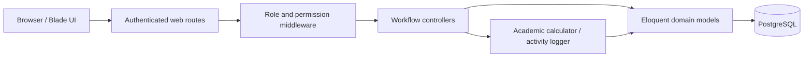

# University Education Management Portal (UEMP)

Assessment project for Lead Web Praxis Media Limited.

| | |
| --- | --- |
| Position | Technology & Engineering Manager |
| Selected workflow | Administrator, with a Department Admin focus |
| Framework | Laravel 13.x |
| Runtime | PHP 8.4 |
| Database | PostgreSQL |
| Development approach | Test-driven development (TDD) |

## Overview

UEMP is a role-based university administration portal. This MVP prioritizes the Department Admin workflow while providing the supporting accounts and controls needed to exercise it end to end.

## Scope

### Department Admin

- Department Admin role and dashboard
- Student and lecturer management, limited to the administrator's department
- Lecturer course assignments and departmental course management
- Student course-registration review and confirmation
- Submitted-result review, approval, rejection, and return for correction
- Department-level academic and registration reports
- Role-based access control (RBAC) and department data isolation

### Supporting roles

- Super Admin (for initial setup)
- Student and Lecturer accounts for exercising the admin workflows

## Core workflows

1. Department administrators manage students, lecturers, and courses in their department.
2. Super Admins configure faculties, departments, programs, levels, academic sessions, semesters, accounts, roles, and permissions.
3. Department administrators allocate courses to active semesters and eligible programs/levels.
4. Students register for active offerings that match their department, program, level, session, and semester.
5. Administrators review registrations; lecturers submit results; Department Admins approve, reject, or return them for correction.
6. Administrators review departmental reports, while Super Admins monitor university-wide totals and administrative activity.

## Architecture

UEMP is a server-rendered Laravel application. Controllers validate requests and enforce workflow rules; Eloquent models express the academic relationships; Blade and Tailwind render role-specific interfaces. PostgreSQL is the intended runtime database, and Spatie Laravel Permission stores roles and permissions.



The academic data model is relational: a Faculty contains Departments; Departments own Programs and Academic Levels; Programs define their available Levels; Academic Sessions contain Semesters; Courses are allocated through Course Offerings to a Semester and optionally a Program/Level. Students link to a Department, Program, and Level. Registrations reference both the Course and the selected Offering.

## Engineering Decisions

- Department Admin authorization is enforced at both route and query/write boundaries. Department-scoped model lookups return `404` for foreign records, avoiding accidental cross-department updates. The Super Admin role is the only role allowed on university setup and account-control routes.
- Workflow permissions are checked in addition to roles. Super Admin can manage permission grants; the seeded roles receive only the permissions needed for their workflows.
- Business mutations use an application service (use case) layer. Controllers keep HTTP validation, department scoping, and response formatting; injected services own account, academic structure, course, registration, review, and result workflows, including transactional updates and activity logging.
- Tradeoff: this adds classes and a layer of indirection, and callers pass validated data and domain models into services. The separation keeps controllers focused on HTTP concerns and gives each workflow a clear place to evolve. Read queries remain in controllers until they become complex enough to justify dedicated query objects.
- Registration eligibility is based on an active Course Offering, not a user-supplied academic year or semester. The current session, semester, course, program, and level must be active and match the student. The server derives the registration year and semester from those records.
- Result scores are bounded at CA 40 and examination 60. Totals and grades are calculated server-side. The assessment does not define a grade-point scale, so this MVP documents an explicit A-F, 4.0-scale assumption and calculates cumulative GPA from approved results only.
- Result submissions and decisions retain result events; administrative actions are also written to a system activity feed. Result state changes and their audit records are saved transactionally.
- Users are deactivated or suspended rather than deleted, preserving registration and result history. Inactive accounts are denied at login and on subsequent authenticated requests.
- PHPUnit defaults to isolated in-memory SQLite. The Docker setup also provides a separate PostgreSQL test database for database-specific validation.

## Implemented Modules

- Department dashboards, scoped student and lecturer profiles, program/level management, course management, lecturer allocation, registration review, result review, and departmental summary/performance reports.
- Super Admin university dashboard, faculty/department/program/level/session/semester setup, account and role/permission management, university-wide registration/result totals, and administrative activity monitoring.
- Student registration against eligible offerings; Lecturer result submission and correction resubmission.

Reports are currently displayed in the portal; file export is not included in this MVP.

## Tech Stack

- Laravel 13.x
- PHP 8.4
- PostgreSQL
- Spatie Laravel Permission for roles and permissions
- Tailwind CSS
- Pest for feature and unit tests (TDD)

## Grading scale

| Score | Grade | Grade points |
| --- | --- | ---: |
| 80-100 | A | 4.0 |
| 70-79 | B | 3.0 |
| 60-69 | C | 2.0 |
| 50-59 | D | 1.0 |
| 0-49 | F | 0.0 |

Cumulative GPA is credit-weighted and uses approved results only. The scale is a documented MVP default and can be changed to match university policy.

## Docker setup

Requirements: Docker Desktop with Docker Compose.

The Compose stack runs PHP 8.4, PostgreSQL 18, a queue worker, and the Vite development server. The database and test suite use separate PostgreSQL databases. The app source is mounted into the PHP container, so PHP changes are available immediately; Vite watches frontend changes.

1. Create the local environment file:

   ```powershell
   Copy-Item .env.example .env
   ```

   For local Docker use, Compose supplies the database connection settings and uses `uemp-local` as the PostgreSQL password by default. You can set `POSTGRES_PASSWORD` in `.env` to choose another local password.

2. Start PostgreSQL, generate the app key, and initialize the development database:

   ```sh
   docker compose up -d db
   docker compose run --rm app php artisan key:generate
   docker compose run --rm app php artisan migrate --seed --force
   ```

3. Start the app, queue worker, and Vite server:

   ```sh
   docker compose up --build -d app worker vite
   ```

   Open <http://localhost:8000>. Vite is available on port 5173, and PostgreSQL is exposed to host tools on port 5433.

View logs and stop the stack with:

```sh
docker compose logs -f app db worker vite
docker compose down
```

The PostgreSQL data is kept in a named Docker volume when the stack stops. `docker compose down -v` removes that volume and permanently deletes the local development and test databases.

## Local setup

Requirements: PHP 8.4, Composer, Node.js with npm, and PostgreSQL.

1. Install PHP and JavaScript dependencies:

	```sh
	composer install
	npm install
	```

2. Create the local environment file and application key:

	```sh
	cp .env.example .env
	php artisan key:generate
	```

3. Set the PostgreSQL connection values in `.env`, then run migrations and seed the local development data:

	```sh
	php artisan migrate --seed
	```

4. Build frontend assets and start the application:

	```sh
	npm run build
	php artisan serve
	```

On Windows PowerShell, use `Copy-Item .env.example .env` in place of `cp`.

The seeded development accounts all use the password `password`:

| Role | Email |
| --- | --- |
| Super Admin | `superadmin@uemp.test` |
| Department Admin | `admin@uemp.test` |
| Lecturer | `lecturer@uemp.test` |
| Student | `student@uemp.test` |

These are local demonstration credentials only. Change or remove them before deploying the application anywhere public.

## Development seed data

`php artisan db:seed` creates 20 students, 20 lecturers, 20 courses, 20 course offerings, and 20 registrations. Other academic tables and audit events are also kept to at most 20 records in the demo dataset. Registration and result records cover pending, confirmed, rejected, submitted, approved, and returned workflows. Student numbers are assigned incrementally in the `UEMP-YYYY-NNNNNN` format.

Student, Super Admin account, registration, and activity lists use server-side filters and 20-row pagination.

## Testing

The default `php artisan test` run uses the in-memory SQLite database configured in `phpunit.xml`. To run the suite against PostgreSQL with Docker, first start the database as described above, then run:

```sh
docker compose --profile testing run --rm test php artisan migrate --force
docker compose --profile testing run --rm test
```

The test profile connects to the separate `uemp_test` database, which is created when the PostgreSQL volume is initialized. The feature and unit suite covers authorization boundaries, department scoping, academic setup, registration eligibility, result approval, account status, grading, and GPA. Never point automated tests at production or a database containing data you need to keep.

## Assessment deliverables

- Working web application and role-specific dashboards
- Database schema and migrations
- Seeded local test accounts for each workflow role
- Automated tests and setup instructions
- Technical documentation for the architecture and key decisions
